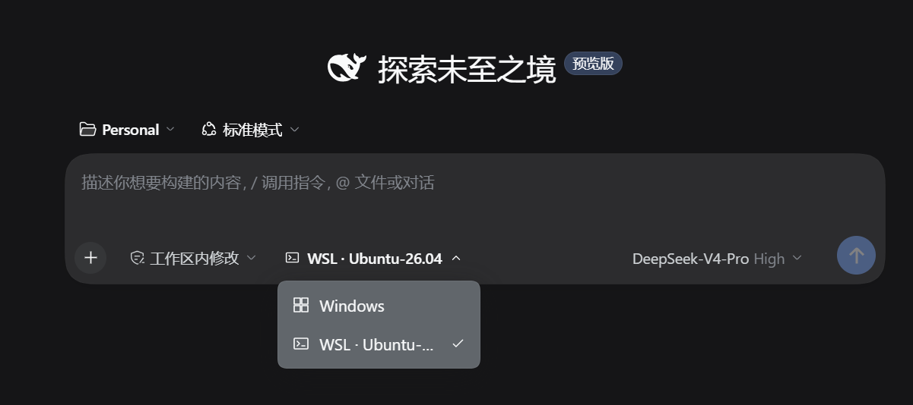

# DSH WSL Environment

这是一个为 **DeepSeek Harness Desktop** 开发的第三方插件。在聊天框里选择 **Windows** 或 **WSL**，决定 Agent 在哪里执行命令，例如安装依赖、构建项目或运行测试。桌面兼容包还会在 WSL 会话的「新建终端」菜单里加入对应发行版，并将它设为该会话的默认终端。



## 使用要求

- **Windows + DSH Desktop `0.2.2-rc.5`**：当前预览版只验证并适配了这一版本。
- **WSL 2**：通过 `\\wsl.localhost\<发行版>\…` 或 `\\wsl$\<发行版>\…` 打开原生 ext4 工作区，例如 `/home/<用户名>/<项目>`。插件会从路径自动识别发行版，无需手动配置 Ubuntu 版本或用户名。
- **发行版内的工具**：所有权限模式都需要 `/bin/bash` 和支持 `pidfd_open`、`pidfd_send_signal` 的 `/usr/bin/python3`。「只读」和「工作区内修改」还需要 `/usr/bin/bwrap`（Bubblewrap）、`libseccomp.so.2` 和 Python 的 `memfd_create`。Node.js 等项目工具也需要安装在所选发行版内。
- **会话模式与权限**：WSL 命令支持内置的**标准模式**和**创造模式**，可选**只读**、**工作区内修改**或**完全权限**。PTC／Minimal 预设暂不支持 WSL 命令。

## 安装与试用

1. 克隆本仓库，在仓库根目录运行 `pnpm pack`，生成 Agent 命令切换插件包。要同时安装右侧 WSL 终端集成，请按[桌面兼容包构建说明](docs/native-terminal-profiles.md#windows-desktop-022-rc5-兼容包)生成 `0.1.0-dev.10` 安装包。
2. 在 DSH Desktop 的 **设置 → 插件 → 添加插件** 中选择生成的 `.tgz`，也可以使用源码包的绝对路径。若 Windows 无法直接链接 WSL 网络路径，使用 `.tgz` 安装即可。不需要修改 DSH 安装文件。
3. 在 WSL 工作区**新建会话**。输入框左侧、权限选项旁边会显示执行环境。默认选择路径对应的 WSL 发行版，也可以在发送首条消息前切换成 Windows。首条消息提交后，当前环境会保存并锁定；想切换就新建会话。
4. 选择 **WSL**，再在权限菜单选「工作区内修改」或「完全权限」。让 Agent 用 `wsl_bash` 执行 `uname -s` 和 `pwd -P`，预期看到 `Linux` 和当前项目的 `/home/…` 路径。

## 权限与已知限制

- WSL 不可用或无法落实当前权限时，插件不会自动切回 Windows，也不会放宽权限。已知的 Windows 命令入口（如内置 PowerShell、工作流、Agent 终端和动态 Cordis 执行）会在 WSL 会话中被拦截；第三方工具不由本插件改写。禁用或卸载插件后，WSL 接管不再生效。
- 「完全权限」下，命令以发行版默认用户运行，使用该用户原有的 Linux 权限和挂载，包括发行版已挂载的 Windows 盘符。
- 受限的 WSL 执行器不会挂载 Windows 盘符，也不会加载用户的 Shell 启动文件。它允许普通 IPv4／IPv6 连接，但不开放本地 Unix 套接字或 WSL 进程通信套接字。
- 「工作区内修改」下，检查无法确认边界时会拒绝执行，例如项目含指向外部的硬链接、嵌套挂载、特殊文件，或文件数太多无法完成检查。遇到外部包缓存或包存储的硬链接，可考虑改用项目内缓存和存储。
- 目前是预览版，尚未完成独立安全审计，也没有发布 GitHub Release 或选择开源许可证。

## 开发与验证

```sh
node test/unit.mjs
node --check client.js
```

使用 Windows Node.js 对 WSL 工作区运行 `node test/probe-wsl-carrier.mjs` 和 `node test/probe-wsl-cancel.mjs`，可以验证跨系统传输和取消。进入 WSL 2 后运行 `python3 -I test/probe-wsl-guest.py`，可以验证 Linux 文件权限边界和超时。实际验证过的环境、测试结果和仍待验证的项目见[开发记录](docs/DEVELOPMENT.md)。
